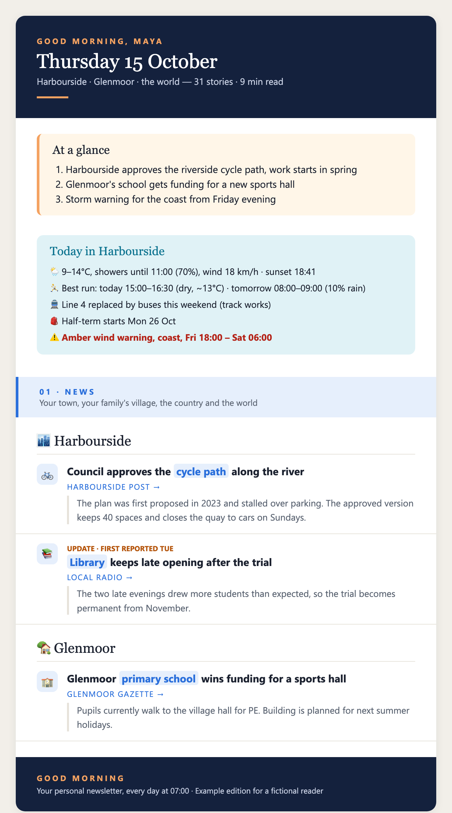
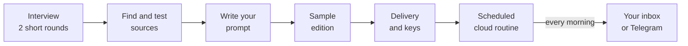

# Buongiorno

**A Claude skill that builds you a personal morning newsletter about your own life.**

You answer a few questions: where you live, where you grew up, your work, your hobbies.
Claude finds and tests news sources for exactly those places and topics, writes the
newsletter's instructions, shows you a sample, and schedules it as a cloud routine. From
then on an email (or a Telegram message) arrives every morning, with a line of context
under every story so it makes sense even if you haven't followed the news.



<sub>Example edition for a fictional reader. Every newsletter the skill builds looks different.</sub>

## What you get

- **Your places, including the small ones.** Your city, your hometown, the village your
  family lives in. Google News search feeds make it possible to follow places that no news
  app covers.
- **Context under every story.** One or two sentences on who's involved, what came before,
  and why it matters to you.
- **A "Today" block.** Weather, the best hour for your run, ride or swim, transport
  disruptions, and alerts for places you care about.
- **Your languages.** News from home in your own language, local news translated into one
  you read easily.
- **Your work.** Your industry, the platforms and rules you depend on, and dated deadlines in
  a "Your actions" box.
- **Optional memory.** With a private git repo it avoids repeating stories, marks follow-ups
  ("Update · first reported Tue") and tracks its own run stats.
- **Optional extras.** An events calendar for the coming months, with prices, and a weekly
  business radar for people who run a company.

## How it works



Setup is one conversation of about 30 minutes. The last 10 minutes (creating an email or
Telegram key and pasting it into a settings page) are easiest on a computer.

## Install

### Claude Code, from the plugin marketplace (recommended)

```
/plugin marketplace add AntonioCappiello/buongiorno
/plugin install buongiorno@buongiorno
```

### Claude Code, by hand

```bash
git clone https://github.com/AntonioCappiello/buongiorno.git
cp -r buongiorno/skills/buongiorno ~/.claude/skills/
```

### Claude desktop app or claude.ai

Download `buongiorno.skill` from the
[latest release](https://github.com/AntonioCappiello/buongiorno/releases/latest), then go to
**Settings › Capabilities › Skills › Upload skill**.

### Start it

Say something like *"build my Buongiorno"* or *"set up a personal morning newsletter"*.

## Requirements

| | |
|---|---|
| **Scheduling** | Claude Code cloud routines (`/schedule`) run even when your computer is off. Claude desktop scheduled tasks work while the app is open. Without either, the skill hands you the finished prompt to schedule later. |
| **Delivery** | One of: Telegram bot, Resend, Postmark, SendGrid, Mailgun, Gmail, or a Slack or Discord webhook. The skill walks you through creating the key. |
| **Memory (optional)** | A private repo on GitHub, Bitbucket or GitLab, with a token limited to that repo. |

Nothing to install: the routine only uses Python's standard library.

## Cost

Every edition is a full Claude session that reads dozens of feeds and writes the newsletter.
A rich daily edition takes about 10 to 20 minutes of agent time and counts toward your
Claude plan's usage limits. Fewer sections and sources make it cheaper. The feeds and data
APIs it uses are free and need no account.

## Security and privacy

The newsletter agent reads text written by strangers every morning while holding your
delivery key, so the skill builds it defensively.

- **Fetched content is treated as data.** The generated prompt has security rules: the agent
  never follows instructions found in articles or feeds, runs only the commands its steps
  describe, contacts only the hosts it needs, and never prints secrets.
- **Fixed recipient.** The delivery script hard-codes your address or chat. Nothing the agent
  reads can change it.
- **Separate environment.** Your keys go in a cloud environment created only for the
  newsletter. In "Default", any other cloud session you start could read them.
- **Narrowest credential.** It recommends a Telegram bot or a send-only email key first. A
  Gmail app password opens the whole mailbox, so it comes last.
- **Tokens stay out of URLs.** Git access uses a request header and a token limited to one
  private repo.
- **No server.** The skill has no backend and collects nothing. Your profile lives in the
  routine's prompt, inside your own Claude account.

What does leave your account: Google News and web searches for your places and topics (place
names, not your name), the finished newsletter through the email or chat service you choose,
and past editions in your private repo if you turn memory on.

**To stop it:** delete the routine, delete its cloud environment, and revoke the key or token.

Install it only from this repository. Each release lists the SHA-256 checksum of
`buongiorno.skill`, so you can check the file you downloaded:
`shasum -a 256 buongiorno.skill`.

To report a vulnerability, see [SECURITY.md](SECURITY.md).

## What's in the repo

```
skills/buongiorno/
├── SKILL.md                     the workflow Claude follows
├── references/
│   ├── interview.md             the questions, and why each one is asked
│   ├── sources.md               finding feeds, Google News recipes, free data APIs
│   ├── prompt-template.md       the newsletter prompt, including the security rules
│   └── delivery.md              Telegram, email providers, Slack, Discord
└── scripts/
    └── check_feeds.py           tests feeds before they go in the prompt
```

The feed checker also works on its own:

```bash
python3 skills/buongiorno/scripts/check_feeds.py --titles 5 \
  "My town|https://news.google.com/rss/search?q=%22Your+Town%22+when:7d&hl=en&gl=GB&ceid=GB:en"
```

## FAQ

**Does it work for a tiny village?** Usually. Google News search feeds pick up local papers
and council news. The skill shows you real recent headlines for your smallest places before
you commit, so you'll know what to expect.

**Can I change it later?** Yes. Ask Claude something like *"change my Buongiorno: drop
the sport section and add news from my sister's town"*. It reads the routine that's
actually running, tests any new sources, makes the smallest edit and offers a test run.

**Where is my newsletter's prompt kept?** In the routine, inside your Claude account. The
skill also saves a copy with its full history in a private folder on your computer
(`~/buongiorno-newsletter/`), and in your private memory repo if you use one, so you can
see what changed and undo it.

**Can I share my newsletter's prompt?** Better not, because it contains personal details.
Share this skill and let others build their own.

**Why "Buongiorno"?** It started as [one Italian developer's](https://antoniocappiello.com/)
own morning email. The skill is what it became once it worked well enough to share.

## Contributing

Feed URLs change and APIs move, so reports of broken sources and better recipes for a
country are very welcome. See [CONTRIBUTING.md](CONTRIBUTING.md).

## License

[MIT](LICENSE) © 2026 [Antonio Cappiello](https://antoniocappiello.com/)
